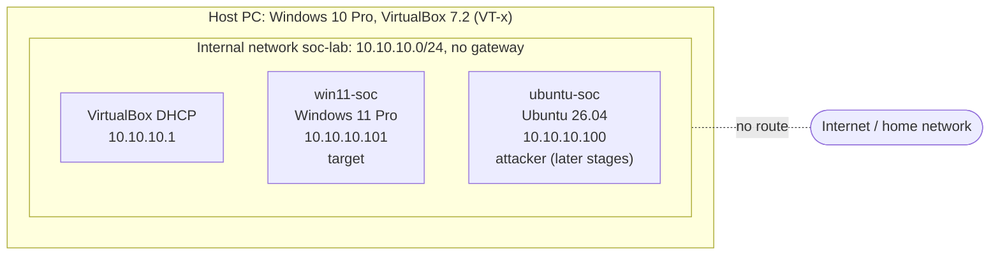

# Home SOC Lab

A small, isolated lab I built at home to practise the work of a SOC analyst (L1): generating security events in a controlled way, finding them in the logs, investigating them, and writing up what happened.

I'm a student of Internet of Things and Cybersecurity at Lviv Polytechnic National University and studied for CompTIA Security+ (SY0-701). This project is where I turn that theory into hands-on practice.

## Lab architecture

- **Isolation:** both VMs sit on a VirtualBox *Internal Network*. There is no gateway, so they can reach each other but not the internet or my home network. I verified this with ping tests (`ping 8.8.8.8` → "Network is unreachable").
- **Firewall:** Windows blocks inbound ping by default. I added one narrow rule that allows ICMP echo only from `10.10.10.0/24`.
- **Snapshots:** each VM has `clean-install` → `isolated-network` restore points, so every experiment starts from a known state.

## What's in this repo

| Path | Contents |
|---|---|
| [`setup/`](setup/) | PowerShell scripts that create and install both VMs unattended with `VBoxManage` |
| [`investigations/exp1/`](investigations/exp1/) | Experiment 1: case notes and incident report |
| [`evidence/exp1/`](evidence/exp1/) | Exported Windows event logs, parsed timeline, screenshots (all SHA-256 hashed) |

## Experiment 1: Password guessing against a local account
**Scenario:** someone at the keyboard guesses the password of a local Windows account and eventually gets in.

**What I did:** created a test account, typed six wrong passwords at the lock screen, then logged in with the right one. Then I switched roles and investigated it only from the logs.

**What I found:**
- Six **Event ID 4625** (failed logon) entries in 9 seconds, all **logon type 2** (at the keyboard) with sub status **`0xC000006A`** (valid username, wrong password), followed by an **Event ID 4624** (successful logon).
- An **unexpected seventh failure** five minutes later that I hadn't caused. I disproved my first explanation, then traced it through a shared session ID to `msedgewebview2.exe` running in the session I'd left open. I assessed it as a benign true positive with medium confidence, and documented why the confidence isn't higher (no process-creation logging; volatile data lost at shutdown).
- MITRE ATT&CK: [T1110.001](https://attack.mitre.org/techniques/T1110/001/) Password Guessing, [T1078.003](https://attack.mitre.org/techniques/T1078/003/) Local Accounts.

📄 **[Read the incident report](investigations/exp1/incident-report.md)** · 📝 [Case notes](investigations/exp1/case-notes.md)

## Skills practised
- Building and isolating a virtual lab (VirtualBox, VBoxManage, network segmentation, snapshots)
- Windows security auditing: audit policy (`auditpol`), account lockout policy, Event IDs 4624 / 4625 / 4647
- Log analysis in Event Viewer and PowerShell (`Get-WinEvent` with XPath filters)
- Building a timeline, testing hypotheses, correlating events by logon ID
- Evidence handling: log export (`wevtutil`), SHA-256 hashing, verified transfer out of an isolated VM
- Writing case notes and an incident report
- Troubleshooting: found from `VBox.log` that VirtualBox couldn't use VT-x because of the Windows hypervisor and VBS, and fixed it

## Tools used so far
VirtualBox · Windows Event Viewer · PowerShell · `auditpol` · `wevtutil` · Ubuntu (network tests)

## Roadmap
- [x] Lab setup and network isolation
- [x] Experiment 1: local password guessing, investigation, report
- [ ] Sysmon: log process creation (fills the gap found in experiment 1)
- [ ] Experiment 2: remote password guessing from Ubuntu over RDP/SMB (logon types 3/10), captured with Wireshark
- [ ] Linux authentication logs (`/var/log/auth.log`, SSH)
- [ ] SIEM (Wazuh or Splunk) with an alert for "failed logons followed by a success"

## Resources
- [Professor Messer's CompTIA Security+ SY0-701 course](https://www.professormesser.com/security-plus/sy0-701/sy0-701-video/sy0-701-comptia-security-plus-course/): the theory behind this lab. Experiment 1 puts several Security+ topics into practice: audit policy and log analysis, account lockout, evidence handling (hashing, chain of custody), and incident documentation.
- [MITRE ATT&CK](https://attack.mitre.org/): technique IDs used in the incident report
- Microsoft documentation for [Event ID 4624](https://learn.microsoft.com/en-us/previous-versions/windows/it-pro/windows-10/security/threat-protection/auditing/event-4624) (successful logon) and [Event ID 4625](https://learn.microsoft.com/en-us/previous-versions/windows/it-pro/windows-10/security/threat-protection/auditing/event-4625) (failed logon): field meanings, logon types and status codes

## Safety
- Everything runs on an isolated internal network; no lab service is exposed to the internet.
- Only lab accounts on lab machines are targeted.
- Passwords used in the lab are lab-only and are not stored in this repository.
