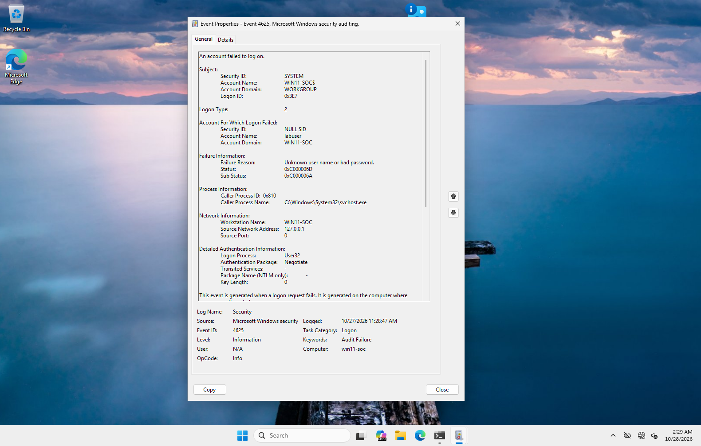
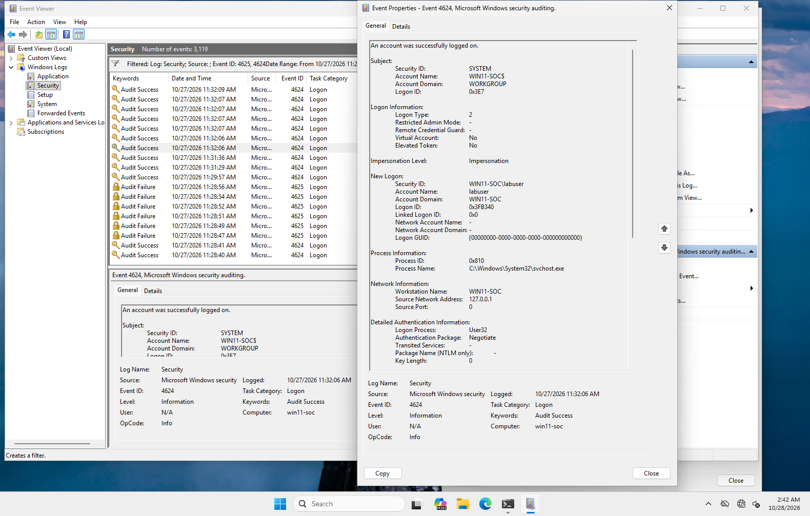
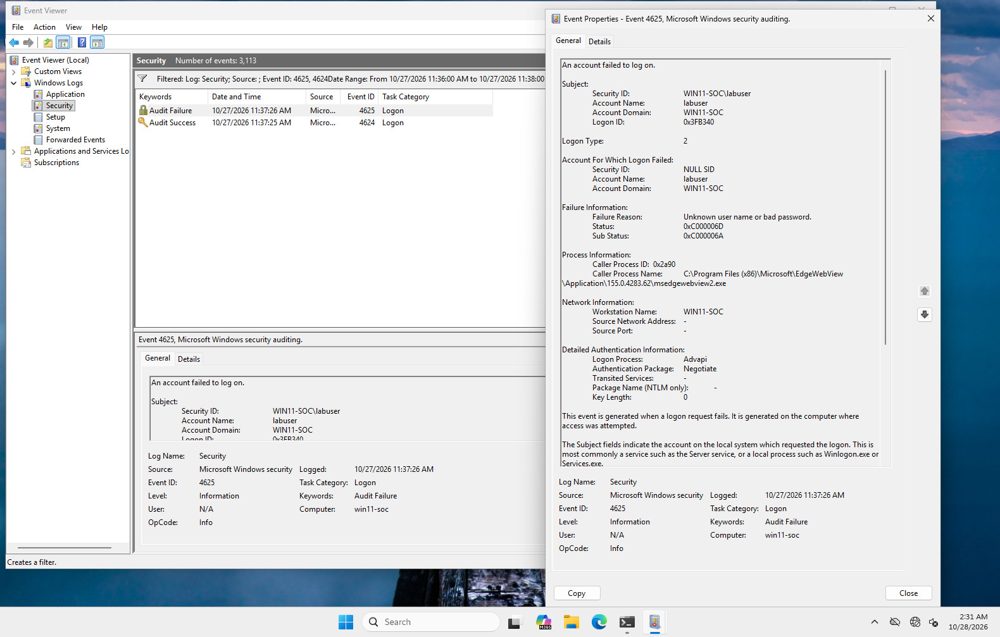

# Incident Report: Password Guessing Against a Local Windows Account

| | |
|---|---|
| **Report ID** | EXP1 |
| **Date of activity** | 2026-10-27, 11:28–11:37 CET (10:28–10:37 UTC) |
| **Host** | `win11-soc`, Windows 11 Pro, 10.10.10.101 (isolated lab network) |
| **Account involved** | `labuser` (local, standard user) |
| **Severity (if this were real)** | Medium: a non-admin account was accessed by guessing its password at the keyboard |
| **Status** | Closed (lab simulation) |
| **Detailed notes** | [case-notes.md](case-notes.md) |

> This was a controlled simulation in my home SOC lab. I performed the "attack" myself, then investigated it from the logs as an analyst would, without relying on what I remembered doing.

---

## 1. What happened
Someone at the keyboard of `win11-soc` tried six wrong passwords for the account `labuser` in nine seconds, then logged in successfully with the right password about three minutes later.

During the investigation I also found a seventh failed logon, five minutes after the activity ended, that I had not caused. I traced it to a Windows component running inside the `labuser` session that had been left open, and assessed it as harmless.

## 2. Timeline

| Time (CET) | Event | What it shows |
|---|---|---|
| 11:28:47–11:28:56 | 6 × **4625** | Failed logons for `labuser`: right username, wrong password (`0xC000006A`), at the keyboard (type 2) |
| 11:32:06 | **4624** | Successful logon as `labuser` (type 2), new session `0x3FB340` |
| 11:32:51 | 2 × **4624** | Tester switches back to the `analyst` account |
| 11:37:26 | **4625** | Failed logon for `labuser`, requested from **inside** session `0x3FB340` by `msedgewebview2.exe` |

## 3. Findings

### 3.1 Password guessing that succeeded
The six failures were all **logon type 2** (interactive), came from `127.0.0.1`, and were handled by the normal Windows sign-in process. That means the attempts were made at the machine itself, not over the network. The sub status `0xC000006A` shows the username was valid each time, so whoever did this already knew the account name.

The successful logon at 11:32:06 came through the same sign-in process. Repeated failures followed by a success on the same account is the classic pattern of a **password guess that worked**.

*Figure 1: First failed logon. Account `labuser`, logon type 2, sub status `0xC000006A`, source `127.0.0.1`.*

*Figure 2: The successful logon at 11:32:06, which created session `0x3FB340`.*

### 3.2 An unexpected failed logon (assessed as harmless)
At 11:37:26 another failed logon for `labuser` appeared, outside the time I had done anything. I worked through it as follows:

1. **My first hypothesis** was that I'd typed my own password into the wrong user tile. The logs disproved it: I was already logged in as `analyst` at 11:32:51, and there was no later `analyst` logon.
2. **The event's Subject** was `labuser` with session ID `0x3FB340`, the same session created by the successful logon. So the request came **from inside the open `labuser` session**.
3. **The requesting program** was `msedgewebview2.exe` (Microsoft Edge WebView2, used by many Windows features), running from its normal install folder.

**Verdict:** benign true positive, **medium confidence**. The event is real, but its cause was most likely a Windows feature in the new session, not an attacker. Confidence is limited because I couldn't identify which app started WebView2 (see Section 5).

*Figure 3: The 11:37:26 failure. Subject is `labuser` (session `0x3FB340`), caller is `msedgewebview2.exe`.*

## 4. MITRE ATT&CK mapping
[MITRE ATT&CK](https://attack.mitre.org/) is a public catalog of attacker techniques that SOC teams use as a shared vocabulary.

| Technique | ID | Where it shows up |
|---|---|---|
| Brute Force: Password Guessing | [T1110.001](https://attack.mitre.org/techniques/T1110/001/) | The six failed logons |
| Valid Accounts: Local Accounts | [T1078.003](https://attack.mitre.org/techniques/T1078/003/) | The successful logon with the guessed password |

## 5. Limitations
- **No process-start logging.** Windows doesn't record process creation by default (no Sysmon, no event 4688), so I couldn't find which app launched WebView2.
- **Volatile data lost.** I shut the VM down before saving the running-process details. The parent process (PID 2080) was gone by the next session.
- **Simulation.** One tester, a known story, and no network-based attempts.

## 6. Recommendations
1. **Log process starts** with Sysmon or the "Process Creation" audit policy (with command lines), so "which program started this?" can be answered after the fact.
2. **Collect volatile data before shutdown or cleanup**: processes with parents, network connections and sessions, saved to files and hashed.
3. **Set a minimum password length.** The current value is 0; the CIS Benchmarks recommend 14 or more.
4. **Review the lockout threshold** (currently 10). Lower it, but not so far that attackers can lock users out on purpose. Keep login throttling on.
5. **Sign out of unused sessions.** The forgotten `labuser` session produced the unexplained event.
6. **Alert on the pattern**: several 4625 events for one account followed by a 4624 for the same account within a short window. This is a good first detection rule for a SIEM.

## 7. Evidence
All files are in [`evidence/exp1/`](../../evidence/exp1/). I hashed them with SHA-256 at collection and verified the hashes after copying them out of the VM. The full hash list is in the [case notes](case-notes.md#7-evidence).

| File | Contents |
|---|---|
| `Security-full.evtx` | Full Security log from `win11-soc` |
| `exp1-logons.evtx` | Only the events relevant to this case |
| `timeline.csv` | Parsed timeline, local time and UTC |
| `screenshots/` | Five Event Viewer screenshots |

## 8. What I learned
- **Filtering is most of the work.** The Security log had over 3,000 events; the case came down to about ten.
- **Sub status codes say what the attacker knows.** `0xC000006A` (right user, wrong password) and `0xC0000064` (user doesn't exist) tell very different stories.
- **Link events by ID, not just by time.** The shared session ID `0x3FB340` proved where the 11:37 event came from. Timing alone only suggested it.
- **Test your own hypotheses.** My first explanation was wrong, and the logs showed it.
- **Collect volatile evidence first.** Shutting down the VM cost me the answer to the last open question.
